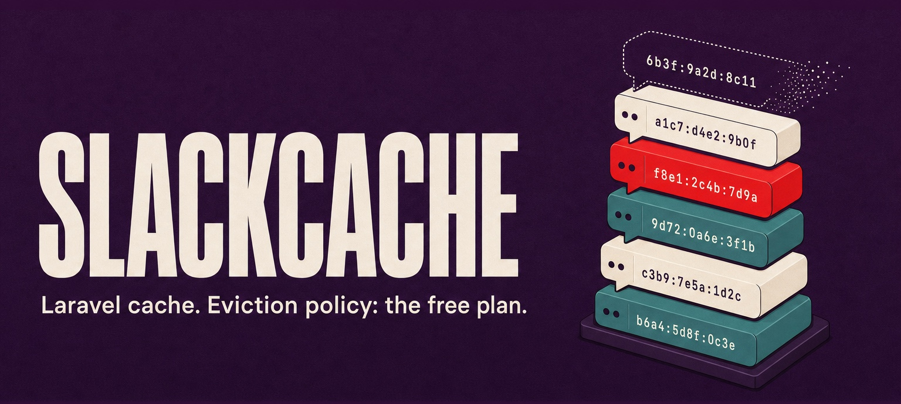

<p align="center">
  
</p>

<p align="center">
  <a href="https://packagist.org/packages/helgesverre/laravel-slackcache"></a>
  <a href="https://github.com/HelgeSverre/laravel-slackcache/actions/workflows/run-tests.yml"></a>
  <a href="https://github.com/HelgeSverre/laravel-slackcache/actions/workflows/phpstan.yml"></a>
  <a href="https://packagist.org/packages/helgesverre/laravel-slackcache"></a>
  
  
  <a href="LICENSE.md"></a>
</p>

# SlackCache for Laravel

A Laravel cache store persisted to a Slack channel. Every key is one Slack message. Eviction policy: the free plan.

Free Slack workspaces hide messages after 90 days. Most teams experience this as data loss. This package treats it as a TTL.

```php
Cache::store('slack')->put('greeting', 'Hello from Laravel. This is a cache.', 3600);

Cache::store('slack')->get('greeting'); // 0.02 ms. Slack was not consulted.
```

The driver implements Laravel's full cache contract: `get`, `put`, `many`, `putMany`, `add`, `increment`, `decrement`, `forever`, `touch`, `forget`, `flush`, `remember` and atomic locks. Every write waits for Slack to accept it. Reads come from a local replica, which re-reads the channel every `sync_interval` seconds; the read that triggers a re-sync waits for it. The channel stays readable, which is more than most caches can say.

> [!NOTE]
> This is a working cache driver, tested against a real workspace. Whether you should use it is between you and whoever gets paged. It is not affiliated with Slack. It posts only to the channel you configure.

## Installation

```bash
composer require helgesverre/laravel-slackcache
```

Requires PHP 8.3+ and Laravel 12.40+ or 13.

## Create the Slack app

1. Print the app manifest:

   ```bash
   php artisan slackcache:manifest
   ```

2. Open [api.slack.com/apps](https://api.slack.com/apps), choose **Create New App → From a manifest**, pick your workspace and paste the manifest.
3. **Install to Workspace**, then copy the **Bot User OAuth Token** (`xoxb-…`).

The manifest asks for `chat:write`, `channels:read`, `channels:history`, `channels:join` and `channels:manage`. The last one creates the cache channel if it does not exist. Slack does not add you to channels a bot creates, so look for `#slackcache` under **Browse channels**. It is worth a look.

## Configuration

Add a store to `config/cache.php`:

```php
'stores' => [

    'slack' => [
        'driver' => 'slack',
        'token' => env('SLACKCACHE_TOKEN'),
        'channel' => env('SLACKCACHE_CHANNEL', 'slackcache'),
        'replica' => env('SLACKCACHE_REPLICA', 'file'),
        'sync_interval' => 30,
        'retention_days' => 90,
        'shards' => 1,
    ],

],
```

```dotenv
SLACKCACHE_TOKEN=xoxb-...
```

| Option | Default | Meaning |
| --- | --- | --- |
| `token` | none | Bot token (`xoxb-…`). A user token also works; the cache then ignores that user's other messages. |
| `channel` | `slackcache` | Channel name or ID. Created and joined on first use. |
| `replica` | none | Another cache store that holds the read copy, e.g. `file`, `redis` or `database`. Without one, every PHP process rebuilds the keyspace from Slack once. |
| `sync_interval` | `30` | Seconds before the replica re-reads the channel to pick up other servers' writes. `null`: only when the replica is cold. |
| `retention_days` | `90` | When Slack hides a message. Keys without a TTL expire then. On a paid plan, set it to `null`. |
| `shards` | `1` | Spread keys over `channel-1` … `channel-N`. See [Sharding](#sharding). |
| `prefix` | `cache.prefix` | Key prefix, as for other stores. |
| `timeout` | `60` | HTTP timeout in seconds. A throttled write can take several. |
| `retries` | `5` | How many HTTP 429s to wait out, using Slack's `Retry-After`. |
| `headers` / `base_url` | none / `https://slack.com/api/` | For proxies and other unusual networks. |

To make Slack your default cache, set `CACHE_STORE=slack`. Do not set the replica to the Slack store itself. The driver checks for this, because someone would.

## How it works

Redis keeps data in memory and persists it to an append-only file. SlackCache keeps data in a replica and persists it to a Slack channel:

| Redis | SlackCache |
| --- | --- |
| Append-only file | `#slackcache` |
| `appendfsync always` | Every write waits for Slack to accept the message |
| Replaying the AOF on startup | Reading the channel history when the replica is cold |
| Active expiry | `php artisan slackcache:reap` |
| `maxmemory-policy allkeys-lru` | `allkeys-slack`: the free plan hides anything not rewritten in 90 days |
| Replicas | Every app server reading the same channel, re-syncing every `sync_interval` seconds |

A write posts a new message, then deletes the key's previous one, so the channel holds one message per live key. If two servers write the same key, the later Slack timestamp wins and the older message is deleted at the next sync. After posting, the driver checks that Slack stored exactly the text it sent. If not, it deletes the message and throws. Nothing is silently truncated.

Each message shows the key, its expiry and a readable preview of the value:

```
SET `laravel-cache-settings` · no TTL (the free plan evicts it in 90 days)
{
    "theme": "dark",
    "regrets": 0
}
```

The message text holds the exact bytes, in the same format as the original [SlackCache](https://github.com/that-guy-wade/slackcache) Redis server (`slackcache:v1 <base64 key> <expiry ms> <base64 value>`). The two can share a channel: values written with `redis-cli` through that server come back as strings, and numbers written by Laravel are readable by `GET`.

Numbers are stored as plain text, like Laravel's Redis store. Everything else is PHP-serialized and honours `cache.serializable_classes`.

## Artisan commands

```bash
php artisan slackcache:load       # Rebuild the replica from the channel history
php artisan slackcache:reap       # Delete the messages of expired keys (20 per run, like Redis)
php artisan slackcache:info       # Channels and settings, in the style of Redis INFO
php artisan slackcache:manifest   # Print the Slack app manifest
```

Expired keys stop being returned straight away, but their messages stay in the channel until reaped. Schedule the reaper:

```php
// routes/console.php
Schedule::command('slackcache:reap --limit=20')->everyMinute();
```

Each command takes `--store=` if your store is not called `slack`.

## Works with the rest of Laravel

The driver is an ordinary cache store, so the rest of Laravel's cache features work on top of it.

### Stale-while-revalidate

`Cache::flexible()` returns the stale value at once and refreshes it after the response is sent. Readers never wait for Slack, which is the idea.

```php
$report = Cache::store('slack')->flexible('report', [300, 3600], fn () => Report::build());
```

### Memoization

`Cache::memo()` keeps values in memory for the rest of the request, so a second read does not even reach the replica:

```php
Cache::memo('slack')->get('settings'); // Replica
Cache::memo('slack')->get('settings'); // Memory. Faster than 0.02 ms.
```

### Sessions

The package registers a `slack` session driver. Every session is a Slack message:

```dotenv
SESSION_DRIVER=slack
SESSION_STORE=slack   # The cache store to use; defaults to "slack"
```

Session payloads are serialized and base64-encoded, not encrypted, unless you set `SESSION_ENCRYPT=true`. Anyone in the channel can read them. Set it.

### Rate limiting

Laravel's rate limiter runs on `add` and `increment`, so it works here. Rate limiting, stored in a rate-limited API:

```php
// config/cache.php
'limiter' => 'slack',
```

```php
RateLimiter::attempt('send-invoice:'.$user->id, 3, fn () => $invoice->send());
```

### Cache commands

`cache:clear` and `cache:forget` work as usual. `cache:clear` deletes every cache message in the channel, at Slack's pace:

```bash
php artisan cache:forget greeting slack
php artisan cache:clear slack
```

### Failover

Laravel's `failover` driver tries stores in order. Slack goes first, as befits a primary:

```php
'failover' => [
    'driver' => 'failover',
    'stores' => ['slack', 'file'],
],
```

### php artisan about

`php artisan about` gets a SlackCache section, read from config without calling Slack:

```
  SlackCache .................................................................
  slack ................ #slackcache · replica: file · allkeys-slack · default
```

## Sharding

Slack's posting limit is per channel, so writes scale the way Redis Cluster does: more shards. `'shards' => 8` spreads keys over `#slackcache-1` … `#slackcache-8` using Redis Cluster's hash slots (CRC16 mod 16384), including `{hash tags}`:

```php
Cache::store('slack')->put('{cart:42}:items', $items, 600);
Cache::store('slack')->put('{cart:42}:total', $total, 600); // same channel
```

Growing a sharded store (2 → 4, 8 → 16) is safe: the old channels are still in the set, so a key stays readable where it is and moves to its new channel the next time it is written. Going from 1 shard to several, or shrinking, leaves keys in channels the store no longer reads. Flush first, or accept the cold start.

## Performance

Measured against a real workspace on 2026-11-03 (one channel, in-process replica, single runs):

| Operation | Time |
| --- | --- |
| `put` | 1,259–1,321 ms |
| `get` | 0.024 ms |

Reads are about 50,000 times faster than writes. This is the correct way round for a cache.

## Limits

- **Value size.** One key and value must fit in one Slack message: 16,000 characters of base64, about 11.9 KB of value. Larger values throw `ValueTooLargeException`. Consider a smaller value, or a database.
- **Write rate.** `chat.postMessage` allows about one message per second per channel, with short bursts. Use [shards](#sharding) for more.
- **Reads of the channel.** History and deletes are Tier 3 (about 50 per minute). `flush()` on a large keyspace takes minutes. So does `slackcache:load`.
- **Atomicity.** `add`, `increment` and locks are atomic across processes that share a replica supporting locks (`redis`, `database`, `file`). Reloads take the same lock, so one process re-reads the channel while the others wait.
- **Several servers.** Give them a shared replica (`redis` or `database`) and they see each other's writes at once. With separate replicas, each sees the others' writes after its next sync, and `forget()` deletes only the message its own replica knows about: if another server wrote the key since, the key comes back at the next sync. Like Slack, this is eventually consistent.
- **Reaping.** Expired keys stop being returned at once, but their messages stay until `slackcache:reap` deletes them. Each run reads the whole channel history and deletes up to `--limit` messages.
- **Retention.** Free workspaces hide messages after 90 days and delete them after a year. The driver accounts for the first. The second is out of scope.
- **App installations.** Free workspaces allow 10.

References: [Slack free plan limits](https://slack.com/help/articles/29414264463635), [rate limits](https://docs.slack.dev/apis/web-api/rate-limits), [chat.postMessage](https://docs.slack.dev/reference/methods/chat.postMessage).

## Testing your application

`FakeSlack` is an in-memory Slack workspace served through Laravel's HTTP fake. It implements the API methods the driver uses, including paginated history, rate limits and truncation:

```php
use HelgeSverre\SlackCache\Testing\FakeSlack;

$slack = FakeSlack::install();

Cache::store('slack')->put('hello', 'world', 60);

expect($slack->messages('slackcache'))->toHaveCount(1);
expect($slack->latest('slackcache')['text'])->toStartWith('slackcache:v1');

$slack->rateLimit(times: 2, retryAfter: 3); // The next two calls get HTTP 429
$slack->fail('channel_not_found');          // The next call fails
```

## Development

```bash
composer test       # Pest, against FakeSlack
composer analyse    # PHPStan, level 8
composer lint       # Pint
```

The live smoke test runs the cache contract against a real workspace, then flushes the channel:

```bash
SLACKCACHE_LIVE_TOKEN=xoxb-... composer test:live
```

It posts to `#slackcache-smoke` (override with `SLACKCACHE_LIVE_CHANNEL`).

## Changelog

See [CHANGELOG](CHANGELOG.md).

## License

MIT. See [LICENSE](LICENSE.md).

## Credits

- [Helge Sverre](https://github.com/HelgeSverre)
- Inspired by [SlackCache](https://github.com/that-guy-wade/slackcache) by [that-guy-wade](https://github.com/that-guy-wade), a Redis-compatible cache stored in a free Slack workspace, part of the "is it a database?" series after GranolaDB and CalendarDB. This package borrows its message format, its hash slots and its eviction policy.
