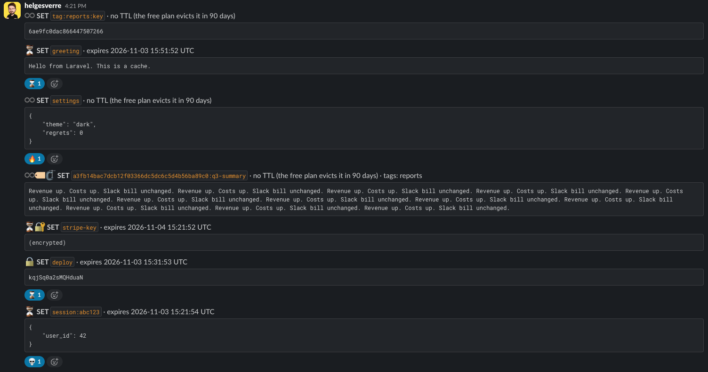

<p align="center">
  
</p>

<p align="center">
  <a href="https://packagist.org/packages/helgesverre/laravel-slackcache"></a>
  <a href="https://github.com/HelgeSverre/laravel-slackcache/actions/workflows/run-tests.yml"></a>
  <a href="https://github.com/HelgeSverre/laravel-slackcache/actions/workflows/phpstan.yml"></a>
  <a href="https://packagist.org/packages/helgesverre/laravel-slackcache"></a>
  
  
  <a href="LICENSE.md"></a>
</p>

# SlackCache for Laravel

A Laravel cache store persisted to a Slack channel. Every key is one Slack message. Eviction policy: the free plan.

Free Slack workspaces hide messages after 90 days. Most teams experience this as data loss. This package treats it as a TTL.

```php
Cache::store('slack')->put('greeting', 'Hello from Laravel. This is a cache.', 3600);

Cache::store('slack')->get('greeting'); // 0.02 ms. Slack was not consulted.
```

The driver implements Laravel's full cache contract: `get`, `put`, `many`, `putMany`, `add`, `increment`, `decrement`, `forever`, `touch`, `forget`, `flush`, `remember` and atomic locks. Every write waits for Slack to accept it. Reads come from a local replica, which re-reads the channel every `sync_interval` seconds; the read that triggers a re-sync waits for it. The channel stays readable, which is more than most caches can say.

> [!NOTE]
> This is a working cache driver, tested against a real workspace. Whether you should use it is between you and whoever gets paged. It is not affiliated with Slack. It posts only to the channel you configure.

## Installation

```bash
composer require helgesverre/laravel-slackcache
```

Requires PHP 8.3+ and Laravel 12.40+ or 13.

## Create the Slack app

1. Print the app manifest:

   ```bash
   php artisan slackcache:manifest
   ```

2. Open [api.slack.com/apps](https://api.slack.com/apps), choose **Create New App → From a manifest**, pick your workspace and paste the manifest.
3. **Install to Workspace**, then copy the **Bot User OAuth Token** (`xoxb-…`).

The manifest asks for `chat:write`, `channels:read`, `channels:history`, `channels:join` and `channels:manage`. `channels:manage` creates the cache channel if it does not exist. It also asks for `reactions:write`, which only the [reactions](#reactions) option uses. Slack does not add you to channels a bot creates, so look for `#slackcache` under **Browse channels**. It is worth a look.

## Configuration

Add a store to `config/cache.php`:

```php
'stores' => [

    'slack' => [
        'driver' => 'slack',
        'token' => env('SLACKCACHE_TOKEN'),
        'channel' => env('SLACKCACHE_CHANNEL', 'slackcache'),
        'replica' => env('SLACKCACHE_REPLICA', 'file'),
        'sync_interval' => 30,
        'retention_days' => 90,
        'shards' => 1,
    ],

],
```

```dotenv
SLACKCACHE_TOKEN=xoxb-...
```

| Option | Default | Meaning |
| --- | --- | --- |
| `token` | none | Bot token (`xoxb-…`). A user token also works; the cache then ignores that user's other messages. |
| `channel` | `slackcache` | Channel name or ID. Created and joined on first use. |
| `replica` | none | Another cache store that holds the read copy, e.g. `file`, `redis` or `database`. Without one, every PHP process rebuilds the keyspace from Slack once. |
| `sync_interval` | `30` | Seconds before the replica re-reads the channel to pick up other servers' writes. `null`: only when the replica is cold. |
| `retention_days` | `90` | When Slack hides a message. Keys without a TTL expire then. On a paid plan, set it to `null`. |
| `shards` | `1` | Spread keys over `channel-1` … `channel-N`. See [Sharding](#sharding). |
| `history` | `false` | Keep previous values in each key's thread. See [Version history](#version-history). |
| `lock_channel` | none | Keep locks in a channel of their own, e.g. `slackcache-locks`. See [Locks](#locks). |
| `prefix` | `cache.prefix` | Key prefix, as for other stores. |
| `timeout` | `60` | HTTP timeout in seconds. A throttled write can take several. |
| `retries` | `5` | How many times to retry a call. HTTP 429s wait for Slack's `Retry-After`; server errors and dropped connections back off 1, 2, 4 … seconds, at most 30. |
| `sync` | `inline` | `background`: re-sync a stale replica from a queued job while reads carry on. See [Background sync](#background-sync). |
| `async` | `false` | Write the replica at once and Slack from a queued job. See [Write-behind](#write-behind). |
| `queue_connection` / `queue` | default | Where the `sync` and `async` jobs run. |
| `emoji` | `false` | Start each message's preview with status emoji. See [Status emoji](#status-emoji). |
| `reactions` | `false` | `true`, or `['hot' => 100, 'expiring' => 3600]`: let `slackcache:decorate` react to hot, expiring and expired keys. See [Reactions](#reactions). |
| `encrypt` | `false` | Encrypt values with your `APP_KEY`. See [Encryption](#encryption). |
| `compress` | `false` | Compress values before storing them. See [Compression](#compression). |
| `files` | `false` | `true`, or `['max_bytes' => 10485760]`: store values too large for a message as Slack files. See [Large values](#large-values). |
| `headers` / `base_url` | none / `https://slack.com/api/` | For proxies and other unusual networks. |

To make Slack your default cache, set `CACHE_STORE=slack`. Do not set the replica to the Slack store itself. The driver checks for this, because someone would.

## How it works

Redis keeps data in memory and persists it to an append-only file. SlackCache keeps data in a replica and persists it to a Slack channel:

| Redis | SlackCache |
| --- | --- |
| Append-only file | `#slackcache` |
| `appendfsync always` | Every write waits for Slack to accept the message |
| Replaying the AOF on startup | Reading the channel history when the replica is cold |
| Active expiry | `php artisan slackcache:reap` |
| `maxmemory-policy allkeys-lru` | `allkeys-slack`: the free plan hides anything not rewritten in 90 days |
| Replicas | Every app server reading the same channel, re-syncing every `sync_interval` seconds |

A write posts a new message, then deletes the key's previous one, so the channel holds one message per live key. If two servers write the same key, the later Slack timestamp wins and the older message is deleted at the next sync. After posting, the driver checks that Slack stored exactly the text it sent. If not, it deletes the message and throws. Nothing is silently truncated.

Each message shows the key, its expiry and a readable preview of the value:

```
SET `laravel-cache-settings` · no TTL (the free plan evicts it in 90 days)
{
    "theme": "dark",
    "regrets": 0
}
```

The message text holds the exact bytes, in the same format as the original [SlackCache](https://github.com/that-guy-wade/slackcache) Redis server (`slackcache:v1 <base64 key> <expiry ms> <base64 value>`). The two can share a channel: values written with `redis-cli` through that server come back as strings, and numbers written by Laravel are readable by `GET`.

Numbers are stored as plain text, like Laravel's Redis store. Everything else is PHP-serialized and honours `cache.serializable_classes`.

## Artisan commands

```bash
php artisan slackcache:decorate   # React to hot, expiring and expired keys (with the reactions option)
php artisan slackcache:doctor     # Check the token, scopes, channels and settings
php artisan slackcache:load       # Rebuild the replica from the channel history
php artisan slackcache:reap       # Delete the messages of expired keys (20 per run, like Redis)
php artisan slackcache:info       # Channels and settings, in the style of Redis INFO
php artisan slackcache:keys       # List live keys matching a pattern, like Redis KEYS
php artisan slackcache:manifest   # Print the Slack app manifest
php artisan slackcache:topic      # Set the channel topic to a count of what it holds
```

Expired keys stop being returned straight away, but their messages stay in the channel until reaped. Schedule the reaper:

```php
// routes/console.php
Schedule::command('slackcache:reap --limit=20')->everyMinute();
```

Each command takes `--store=` if your store is not called `slack`.

### Doctor

`slackcache:doctor` checks a store end to end and exits non-zero if anything fails, so it also works as a deploy check:

```
  Store ...................................... ✓ [slack] uses the slack driver
  Token ............................... ✓ bot token · Acme · slackcache
  Scopes ... ✓ chat:write, channels:read, channels:history, channels:join, channels:manage
  Channels ........................................ ✓ #slackcache (C0123456789)
  Post and delete #slackcache .................................. ✓ ok
  History #slackcache ....................... ✓ 12 messages from this token
  Replica ............................................ ✓ [redis], with locks

   INFO  All checks passed.
```

It posts one message and deletes it again. It creates the channel if it does not exist, as the first write would. Scopes are checked for bot and user tokens; other token types report Slack's own scopes, which say nothing about this app.

## Background sync

By default, the read that finds the replica older than `sync_interval` re-reads the channel before it returns. On a large keyspace that read waits seconds. Set `'sync' => 'background'` and it returns from the replica at once, and a queued job re-reads the channel:

```php
'slack' => [
    'driver' => 'slack',
    // ...
    'sync' => 'background',
    'queue' => 'slackcache', // optional
],
```

Notes:

- One re-sync job is queued at a time per channel set.
- A cold replica, one that has never loaded, still loads during the read: there is nothing to serve yet.
- While a job is queued, reads serve what the replica has. Entries stay in the replica for at least an hour (or until their own TTL ends), so a slow queue means older data, not misses.
- On the `sync` queue driver the job runs straight away, which is the inline behaviour with extra steps.

## Write-behind

A write waits for Slack: about 1.3 seconds. Set `'async' => true` and `put`, `forever`, `increment`, `add`, `touch` and `forget` update the replica and return; a queued job writes Slack:

```php
'slack' => [
    'driver' => 'slack',
    // ...
    'replica' => 'redis',
    'async' => true,
    'queue' => 'slackcache',
],
```

```php
Cache::store('slack')->put('greeting', 'Hello', 3600); // Milliseconds. Slack hears about it shortly.
Cache::store('slack')->get('greeting');                // 'Hello', from the replica
```

Each write gets a sequence number from the clock. A queued job that finds the key has changed since, written again, forgotten or flushed, skips itself. So jobs that run late, twice or out of order never put an older value in Slack. Between servers, the later write by wall clock wins, the same rule Slack's timestamps apply.

Queue workers must use the same replica as the app: it is where jobs find out what happened to a key since they were queued. Use `redis` or `database`, or `file` when the workers run on the same machine. The driver refuses `async` and `'sync' => 'background'` without a replica, and `slackcache:doctor` warns about replicas that cannot be shared.

Trade-offs, all of which come with write-behind caches in general:

- **Durability.** Until its job runs, a write exists only in the replica, which keeps it for up to a day. If the replica is lost first (an `array` replica and the process ends, say), so is the write. Use `redis` or `database`.
- **Other servers** with separate replicas see a write after its job has run and they have synced. With a shared replica they see it at once.
- **Reloads.** A re-sync keeps queued writes and deletes, including keys Slack has not seen yet.
- **Failed jobs** retry as your queue is configured. A job that gives up leaves the write in the replica only.
- **Not with `history`.** History replies need each write to see the one before it; the driver refuses the combination.
- **Flush stays synchronous.** `flush()` deletes from Slack before it returns, and queued writes from before it are dropped.
- **Locks** are atomic through the replica either way. Without `lock_channel`, acquiring and releasing them is written behind like any key; with it, the lock channel is synchronous.

On the `sync` queue driver jobs run straight away, so `async` behaves like the default.

## Encryption

Everyone in the channel can read the cache. To change that, set `'encrypt' => true`. Values are encrypted with Laravel's encrypter, so your `APP_KEY`, and `APP_PREVIOUS_KEYS` during a key rotation:

```php
'slack' => [
    'driver' => 'slack',
    // ...
    'encrypt' => true,
],
```

```
SET `laravel-cache-api-token` · expires 2026-11-03 15:00:00 UTC
(encrypted)
```

Notes:

- Keys are not encrypted: they are how the driver finds values. Keep secrets out of key names.
- Previews and history replies show `(encrypted)`.
- A value that cannot be decrypted, after a key change say, is a cache miss.
- Values written before you turned encryption on are still read. New writes are encrypted.
- Laravel's encrypted payload is about 1.8 times the size of the value, plus around 200 characters, so the largest value that fits drops to about 6.5 KB. Combine it with compression to win that back.

## Compression

Set `'compress' => true` to gzip values before they are stored. JSON, HTML and other text usually shrink to a fraction of their size, so values well over the 11.9 KB message limit fit:

```php
Cache::store('slack')->put('report', $fortyKilobytesOfJson, 3600); // Fits, compressed
```

Notes:

- A value is stored compressed only when that makes it smaller. Short and already-compressed values are stored as they are.
- The preview still shows the readable value.
- With `encrypt` on too, values are compressed first, then encrypted.
- Compressed values carry a marker, so turning compression off later still reads them. The Python SlackCache server sees the raw compressed bytes.
- Needs PHP's zlib extension, which almost every PHP build has.

## Large values

One Slack message holds about 11.9 KB of value. With `files` on, a larger value is uploaded to Slack as a file, and the key's message holds a pointer to it instead:

```php
'slack' => [
    'driver' => 'slack',
    // ...
    'files' => true, // or ['max_bytes' => 10 * 1024 * 1024]
],
```

```
📎 SET `reports:2026` · no TTL (the free plan evicts it in 90 days) · stored as a file, 2,483,112 bytes
```

The file is uploaded without sharing it in any channel, so it does not appear in the channel, and only the token that uploaded it can read it. The message keeps the readable preview. Values that fit in a message are stored as before; `files` only changes what happens instead of `ValueTooLargeException`.

| | |
| --- | --- |
| Pointer | `slackcache:v1 <base64 key> <expiry> @<file ID>:<sha256>`. The hash is checked on download; a mismatch is a cache miss. |
| Reads | From the replica, as always. A reload downloads each large value once and reuses it while the message is unchanged. |
| Writes | Upload (3 calls), then post. If the post fails, the file is deleted again. |
| Deletes | Replacing, forgetting, reaping and flushing a key delete its file too. |
| Limit | `max_bytes`, default 10 MB, after compression and encryption. Larger values still throw `ValueTooLargeException`. |
| Scopes | `files:write` and `files:read`. `slackcache:doctor` checks them when `files` is on. |

With `history` on, a key whose new or old value is a file is reposted instead of edited, starting a new thread. The original Python server ignores pointer messages, as it ignores everything else it does not understand.

## Cache tags

The store supports [cache tags](https://laravel.com/docs/cache#cache-tags). Each tagged message lists its tags, so people can see what a key belongs to:

```php
Cache::store('slack')->tags(['people', 'artists'])->put('John', $john, 600);

Cache::store('slack')->tags(['people', 'artists'])->get('John');
```

```
SET `laravel-cache-11f6ad8ec52a2984abaafd7c3b516503785c2072:John` · expires 2026-11-03 14:12:00 UTC · tags: people, artists
```

Flushing tags works as in Laravel: every key stored under any of the flushed tags becomes unreachable at once. The driver also deletes the messages of keys stored under exactly the flushed tags:

```php
Cache::store('slack')->tags(['people'])->flush();
```

Keys stored under a larger set of tags (`['people', 'artists']` above) become unreachable too, but their messages stay in the channel until they expire, are reaped, or the free plan evicts them. Laravel's Redis store has the same problem and a command for it. The free plan is ours.

### Sections

Laravel 4.0 called them cache sections. Laravel 4.1 renamed them to tags. This store still answers to the old name:

```php
Cache::store('slack')->section('people')->put('John', $john, 600);
```

`section('people')` is `tags(['people'])`. When Slack is your default store, `Cache::section('people')` works too.

## Locks

[Atomic locks](https://laravel.com/docs/cache#atomic-locks) are ordinary keys, so by default they live in the cache channel:

```php
Cache::store('slack')->lock('deploy', 120)->get(function () {
    // One deploy at a time. The lock is a Slack message.
});
```

Set `lock_channel` to give locks a channel of their own. The cache channel then holds only cache, and locks can be flushed without touching it:

```php
'slack' => [
    'driver' => 'slack',
    // ...
    'lock_channel' => 'slackcache-locks',
],
```

```php
Cache::store('slack')->getStore()->flushLocks(); // Deletes every lock message, nothing else
```

```bash
php artisan cache:clear slack --locks   # Laravel 13
```

Without `lock_channel`, `flushLocks()` throws, as Laravel's own stores do when locks share the cache.

A lock that is never released (a crashed worker, say) expires, but its message stays. `slackcache:reap` reaps the lock channel too, after the cache channel, within the same `--limit`.

## Status emoji

Set `'emoji' => true` and each message's preview starts with emoji saying what kind of key it is. With [reactions](#reactions) on as well, a real channel looks like this:

<p align="center">
  
</p>

In text:

```
⏳ SET `laravel-cache-report` · expires 2026-11-03 15:00:00 UTC
♾️ SET `laravel-cache-settings` · no TTL (the free plan evicts it in 90 days)
🔒 SET `laravel-cache-deploy` · expires 2026-11-03 14:01:00 UTC
♾️🏷️🔐🗜️ SET `laravel-cache-11f6ad8ec52a2984abaafd7c3b516503785c2072:summary` · no TTL (the free plan evicts it in 90 days) · tags: reports
```

| Emoji | Slack name | Meaning |
| --- | --- | --- |
| ⏳ | `:hourglass_flowing_sand:` | Has a TTL |
| ♾️ | `:infinity:` | No TTL |
| 🔒 | `:lock:` | A lock |
| 🏷️ | `:label:` | Tagged |
| 🔐 | `:closed_lock_with_key:` | Encrypted |
| 🗜️ | `:compression:` | Compressed |

The emoji are part of the message's blocks, so they cost no extra API calls. The message text, which holds the value, is unchanged.

## Reactions

Some states only exist after a key is written: it is read a lot, it is about to expire, it has expired and waits for the reaper. With `reactions` on, `slackcache:decorate` marks them with reactions:

```php
'slack' => [
    'driver' => 'slack',
    // ...
    'reactions' => [
        'hot' => 100,       // 🔥 after this many reads of the current value
        'expiring' => 3600, // ⌛ when the TTL ends within this many seconds
    ],
],
```

```php
// routes/console.php
Schedule::command('slackcache:decorate --limit=20')->everyFiveMinutes();
```

| Reaction | Slack name | Meaning |
| --- | --- | --- |
| 🔥 | `:fire:` | Read at least `hot` times. Counts are kept per message for a day, so a rewritten key starts cold. |
| ⌛ | `:hourglass:` | Expires within `expiring` seconds |
| 💀 | `:skull:` | Expired, waiting for `slackcache:reap` |

The screenshot under [Status emoji](#status-emoji) shows all three on a real channel.

Notes:

- `'reactions' => true` uses the defaults shown above.
- Reads are counted in the replica, never in Slack, and only when `reactions` is on: one replica increment per hit.
- Each run compares the reactions each key should have with the ones the driver already added, and only adds or removes the difference. A run with nothing new makes no reaction calls.
- `--limit` caps reaction calls per run (default 20). Slack allows about 50 per minute.
- Reactions people add are theirs: the command only touches its own, and only these three.
- Without `history`, a rewrite is a new message, so its reactions start over. With `history`, the message is edited in place, and the next run takes off reactions that no longer apply.
- The lock channel is decorated too.
- Needs the `reactions:write` scope, which the manifest includes. `slackcache:doctor` checks for it when `reactions` is on.

## Channel topic

`slackcache:topic` sets each cache channel's topic to a count of what it holds, so anyone who wanders in knows what they are looking at:

```
3 keys · 1 expires within the hour · 1 never expires · Cache storage. Please do not chat here; it is not that kind of channel.
```

A sharded store gets one per channel, starting with `Shard 2 of 8`. Slack announces every topic change with a "set the channel topic" message. The command deletes that notice again, so the channel holds cache messages and nothing else; pass `--keep-notice` to leave it. A topic that has not changed is left alone, so the command can run often:

```php
// routes/console.php
Schedule::command('slackcache:topic')->everyTenMinutes();
```

Each run reads the channel history, like `slackcache:keys`. It needs `channels:manage` (in the manifest) or `channels:write.topic`. For your own wording, call the keyspace directly:

```php
Cache::store('slack')->getStore()->keyspace()->updateTopics(
    fn (array $row) => "{$row['keys']} keys. {$row['forever']} of them are forever. Nothing is forever.",
);
```

## Version history

Set `'history' => true` and overwriting a key edits its message in place instead of replacing it. The previous value goes into the message's thread:

```php
Cache::store('slack')->forever('config', ['theme' => 'light']);
Cache::store('slack')->forever('config', ['theme' => 'dark']);
```

```
SET `laravel-cache-config` · no TTL (the free plan evicts it in 90 days)
{
    "theme": "dark"
}
  └ 1 reply
    Previous value, replaced 2026-11-03 13:41:07 UTC:
    {
        "theme": "light"
    }
```

Every write, increment and `touch` adds a reply. The channel still holds one message per key, since thread replies do not appear in the channel history. You get an audit log for the price of a second API call per write.

Notes:

- With history on, a write is `chat.update` plus a thread reply, so it takes about twice as long. If Slack stores different text than was sent, the driver puts the previous value back and throws. If the reply fails, the write still counts; the error goes to your exception handler.
- Slack hides messages by creation time, and an edit keeps the creation time. So once a key's message is past half of `retention_days` (45 days on the free plan), the next write posts a fresh message and the thread starts over. Rewritten keys outlive the free plan; their history does not.
- If another server deleted the key's message since your last sync, the write posts a new one.
- Deleting a key deletes its thread first. Slack would otherwise keep a "This message was deleted." placeholder for the thread. That is one extra history read per delete.
- An edit does not change a message's Slack timestamp. If two servers with separate replicas write the same key, the message created later wins, not the one edited later.
- Turning history off later leaves existing threads in place. Deleting those keys then leaves Slack's placeholder. Flush with history on first if this matters to you.

## Listing keys

`slackcache:keys` lists live keys matching a glob pattern, the way Redis `KEYS` does. It supports `*`, `?` and `[abc]` and leaves out the store prefix:

```bash
php artisan slackcache:keys 'user:*'
```

```
   WARN  KEYS reads the whole channel history. Redis advises against KEYS in production. So do we.

user:1
user:2

   INFO  2 keys.
```

It reads the channel rather than the replica, so it also shows keys other servers wrote since your last sync.

## Works with the rest of Laravel

The driver is an ordinary cache store, so the rest of Laravel's cache features work on top of it.

### Stale-while-revalidate

`Cache::flexible()` returns the stale value at once and refreshes it after the response is sent. Readers never wait for Slack, which is the idea.

```php
$report = Cache::store('slack')->flexible('report', [300, 3600], fn () => Report::build());
```

### Memoization

`Cache::memo()` keeps values in memory for the rest of the request, so a second read does not even reach the replica:

```php
Cache::memo('slack')->get('settings'); // Replica
Cache::memo('slack')->get('settings'); // Memory. Faster than 0.02 ms.
```

### Sessions

The package registers a `slack` session driver. Every session is a Slack message:

```dotenv
SESSION_DRIVER=slack
SESSION_STORE=slack   # The cache store to use; defaults to "slack"
```

Session payloads are readable by anyone in the channel unless they are encrypted. Set `SESSION_ENCRYPT=true`, or turn on [`encrypt`](#encryption) for the store.

### Rate limiting

Laravel's rate limiter runs on `add` and `increment`, so it works here. Rate limiting, stored in a rate-limited API:

```php
// config/cache.php
'limiter' => 'slack',
```

```php
RateLimiter::attempt('send-invoice:'.$user->id, 3, fn () => $invoice->send());
```

### Cache commands

`cache:clear` and `cache:forget` work as usual. `cache:clear` deletes every cache message in the channel, at Slack's pace:

```bash
php artisan cache:forget greeting slack
php artisan cache:clear slack
```

### Failover

Laravel's `failover` driver tries stores in order and moves to the next one when a store throws. Slack goes first, as befits a primary:

```php
'stores' => [

    'slack' => [
        'driver' => 'slack',
        'token' => env('SLACKCACHE_TOKEN'),
        'replica' => 'file',
        'retries' => 0,  // fail over now, instead of after 1 + 2 + 4 + 8 + 16 seconds of backoff
        'timeout' => 5,
    ],

    'cache' => [
        'driver' => 'failover',
        'stores' => ['slack', 'database'],
    ],

],
```

```dotenv
CACHE_STORE=cache
```

Reads come from the replica, so they keep working while Slack is down, until the next re-sync needs the channel. Writes throw at once and land in the next store. Laravel fires `Illuminate\Cache\Events\CacheFailedOver` the first time each store fails.

The stores do not sync with each other. A value written to `database` during an outage stays there, and once Slack is back, reads return Slack's older copy of the key, if it has one. Keep TTLs short on keys that matter, or flush the fallback after an outage. Do not put the slack store's own replica in the failover list.

### php artisan about

`php artisan about` gets a SlackCache section, read from config without calling Slack:

```
  SlackCache .................................................................
  slack ................ #slackcache · replica: file · allkeys-slack · default
```

## Events

Laravel's cache events (`CacheHit`, `KeyWritten`, …) fire as for any store. The driver adds events for the Slack side, in `HelgeSverre\SlackCache\Events`:

| Event | When | Properties |
| --- | --- | --- |
| `SlackRateLimited` | Slack answered HTTP 429; the driver waits and retries | `method`, `retryAfter`, `attempt` |
| `SlackRequestRetrying` | A server error or dropped connection; the driver backs off and retries | `method`, `reason`, `attempt`, `delay` |
| `KeyspaceReloaded` | The replica was rebuilt from the channel | `channels`, `keys`, `milliseconds` |
| `HistoryReplyFailed` | With `history` on, a value was stored but its thread reply failed | `key`, `exception` |

```php
Event::listen(SlackRateLimited::class, function (SlackRateLimited $event) {
    Log::warning("Slack throttled {$event->method} for {$event->retryAfter}s");
});
```

Retries after a timeout can post a message twice. The duplicate holds the same key, and the next reload keeps the newer message and deletes the other.

## Sharding

Slack's posting limit is per channel, so writes scale the way Redis Cluster does: more shards. `'shards' => 8` spreads keys over `#slackcache-1` … `#slackcache-8` using Redis Cluster's hash slots (CRC16 mod 16384), including `{hash tags}`:

```php
Cache::store('slack')->put('{cart:42}:items', $items, 600);
Cache::store('slack')->put('{cart:42}:total', $total, 600); // same channel
```

Growing a sharded store (2 → 4, 8 → 16) is safe: the old channels are still in the set, so a key stays readable where it is and moves to its new channel the next time it is written. Going from 1 shard to several, or shrinking, leaves keys in channels the store no longer reads. Flush first, or accept the cold start.

## Performance

Measured against a real workspace on 2026-11-03 (one channel, in-process replica, single runs):

| Operation | Time |
| --- | --- |
| `put` | 1,259–1,321 ms |
| `get` | 0.024 ms |

Reads are about 50,000 times faster than writes. This is the correct way round for a cache. If it is not the way round you wanted, see [Write-behind](#write-behind).

## Limits

- **Value size.** One key and value must fit in one Slack message: 16,000 characters of base64, about 11.9 KB of value. Larger values throw `ValueTooLargeException`. Turn on [compression](#compression), or [files](#large-values) for up to 10 MB, consider a smaller value, or a database.
- **Write rate.** `chat.postMessage` allows about one message per second per channel, with short bursts. Use [shards](#sharding) for more.
- **Reads of the channel.** History and deletes are Tier 3 (about 50 per minute). `flush()` on a large keyspace takes minutes. So does `slackcache:load`.
- **Atomicity.** `add`, `increment` and locks are atomic across processes that share a replica supporting locks (`redis`, `database`, `file`). Reloads take the same lock, so one process re-reads the channel while the others wait.
- **Several servers.** Give them a shared replica (`redis` or `database`) and they see each other's writes at once. With separate replicas, each sees the others' writes after its next sync, and `forget()` deletes only the message its own replica knows about: if another server wrote the key since, the key comes back at the next sync. Like Slack, this is eventually consistent.
- **Reaping.** Expired keys stop being returned at once, but their messages stay until `slackcache:reap` deletes them. Each run reads the whole channel history and deletes up to `--limit` messages.
- **Retention.** Free workspaces hide messages after 90 days and delete them after a year. The driver accounts for the first. The second is out of scope.
- **App installations.** Free workspaces allow 10.

References: [Slack free plan limits](https://slack.com/help/articles/29414264463635), [rate limits](https://docs.slack.dev/apis/web-api/rate-limits), [chat.postMessage](https://docs.slack.dev/reference/methods/chat.postMessage).

## Testing your application

`SlackCache::fake()` swaps Slack for an in-memory workspace. Every store that uses the slack driver is rebuilt against it with a fresh in-process replica, so no test sees another test's keys, and a missing `SLACKCACHE_TOKEN` is filled in. Then assert on what was stored:

```php
use HelgeSverre\SlackCache\SlackCache;

it('caches the weekly report', function () {
    $slack = SlackCache::fake();

    $this->get('/reports/weekly')->assertOk();

    $slack->assertStored('reports:weekly');
    $slack->assertStored('reports:weekly', fn (array $report) => $report['total'] > 0);
    $slack->assertNotStored('reports:draft');
    $slack->assertStoredCount(1);
});
```

| Method | Asserts |
| --- | --- |
| `assertStored($key)` | The key has a message in Slack and has not expired |
| `assertStored($key, $value)` | … and holds that value (`assertEquals`) |
| `assertStored($key, fn ($value) => …)` | … and the callback returns true |
| `assertNotStored($key)` | The key has no live message |
| `assertStoredCount($n)` / `assertNothingStored()` | How many live keys Slack holds |
| `stored()` | Returns every live key and its value, for your own assertions |

Keys are without the cache prefix. Values are read back through the store: unserialized, and decrypted and inflated when `encrypt` or `compress` is on. Messages from people in the channel are ignored, as the driver ignores them.

The fake is `HelgeSverre\SlackCache\Testing\FakeSlack`. It implements the API methods the driver uses, including paginated history, rate limits and truncation, and can misbehave on request:

```php
use HelgeSverre\SlackCache\Testing\FakeSlack;

$slack = FakeSlack::install(); // The fake alone, without rebuilding stores

Cache::store('slack')->put('hello', 'world', 60);

expect($slack->messages('slackcache'))->toHaveCount(1);
expect($slack->latest('slackcache')['text'])->toStartWith('slackcache:v1');

$slack->rateLimit(times: 2, retryAfter: 3); // The next two calls get HTTP 429
$slack->fail('channel_not_found');          // The next call fails
$slack->serverError(times: 2, status: 503); // The next two calls get HTTP 503
$slack->disconnect();                       // The next call drops the connection
$slack->reactAs('U0HUMAN', 'slackcache', $ts, 'eyes'); // Someone else reacts
$slack->replies('slackcache', $ts);         // A message's thread, with `history` on
$slack->beforeNext('conversations.history', fn () => /* interleave another process */ null);
```

## AI assistants

The package ships [Laravel Boost](https://laravel.com/docs/boost) guidelines and a `slackcache-development` skill. `php artisan boost:install` picks them up, so your coding assistant knows to configure a replica, fake Slack in tests, and run `slackcache:doctor` before rewriting your cache layer.

## Development

```bash
composer test       # Pest, against FakeSlack
composer analyse    # PHPStan, level 8
composer lint       # Pint
```

The live smoke test runs the cache contract against a real workspace, then flushes the channel:

```bash
SLACKCACHE_LIVE_TOKEN=xoxb-... composer test:live
```

It posts to `#slackcache-smoke` (override with `SLACKCACHE_LIVE_CHANNEL`).

## Changelog

See [CHANGELOG](CHANGELOG.md).

## License

MIT. See [LICENSE](LICENSE.md).

## Credits

- [Helge Sverre](https://github.com/HelgeSverre)
- Inspired by [SlackCache](https://github.com/that-guy-wade/slackcache) by [that-guy-wade](https://github.com/that-guy-wade), a Redis-compatible cache stored in a free Slack workspace, part of the "is it a database?" series after GranolaDB and CalendarDB. This package borrows its message format, its hash slots and its eviction policy.
